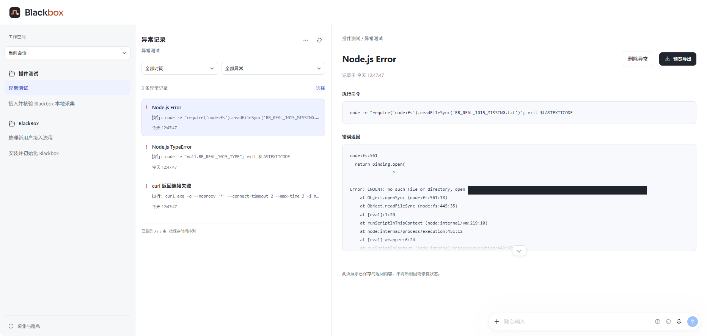
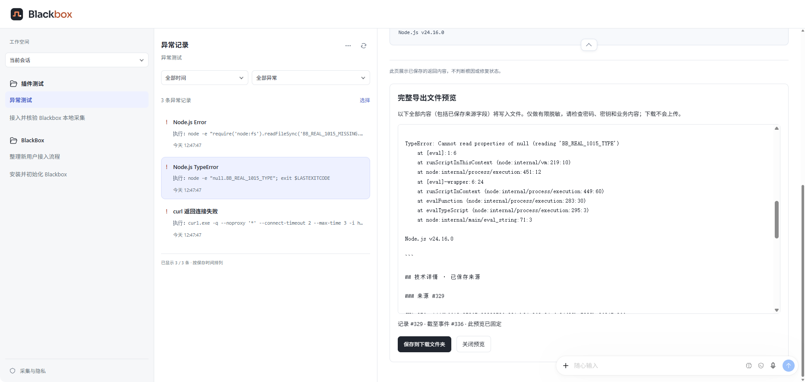
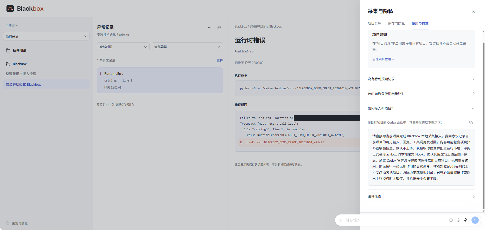

<p align="center">
  
</p>

<h1 align="center">Blackbox Plugin</h1>

<p align="center">Agent 的本地执行异常记录本</p>

<!-- blackbox:published:start -->
<p align="center">
  <a href="https://github.com/zemekeznb/blackbox-plugin/releases/tag/v0.4.0-alpha.6.47"></a>
  <a href="LICENSE"></a>
  <a href="docs/INSTALL.md"></a>
  <a href="docs/INSTALL.md"></a>
</p>
<!-- blackbox:published:end -->

<p align="center">
  <strong>简体中文</strong> ·
  <a href="README.en.md">English</a> ·
  <a href="docs/INSTALL.md">安装指南</a> ·
  <a href="docs/DEVELOPMENT.md">开发与发布</a> ·
  <a href="https://github.com/zemekeznb/blackbox-plugin/releases">版本记录</a>
</p>

按项目和会话回看执行错误、保存的命令返回与后续操作，把问题现场整理成可复核的 Markdown 记录。默认保存在本机，只记录你明确接入的项目。



*当前界面截图；宿主边框已裁剪，本机用户名与路径已遮挡。*

## 快速安装

<!-- blackbox:published:start -->
当前版本 **0.4.0-alpha.6.47**。准备好 **Windows、Codex 桌面版、现有 Python 3.11+（可使用 Codex 提供的运行时）**，以及能够访问 GitHub 的网络。无需 Git、GitHub 登录或单独安装 Codex CLI。
<!-- blackbox:published:end -->

此入口始终对应已公开发布并通过下载验证的版本。

**交给 Codex 安装：** 打开 Codex 桌面版，在会话中复制发送：

<!-- blackbox:published:start -->
```text
请按 https://github.com/zemekeznb/blackbox-plugin/blob/v0.4.0-alpha.6.47/release/INSTALL-CODEX.md 为我安装并初始化 Blackbox，然后打开界面。暂不启用任何项目采集，不修改模型、账号或系统环境配置。
```
<!-- blackbox:published:end -->

Codex 会检查依赖、下载并校验插件、完成安装与初始化，并分别报告原生入口和页面打开情况。**安装不会自动启用项目采集。** 详细步骤与排查见[安装指南](docs/INSTALL.md)。

**安装验收：** .46 已包含宿主运行绑定修复，使用已核实的 Python 绝对路径启动后台，不依赖系统 Python PATH。干净电脑上的侧边栏、重启和新会话仍需实际验收；网页能打开不等于原生入口正常。若出现访问拒绝，请保留具体错误，不要反复重装或更换数据目录。

## 它能帮你做什么

| 能力 | 用途 |
| --- | --- |
| 按项目、会话回看 | 找到已收到并识别的执行异常 |
| 命令与返回对照 | 查看保存的来源，减少凭记忆描述问题 |
| 后续操作关联 | 查看保守关联的相同输入再次调用，不自动判定修复成功 |
| 筛选与 Markdown 导出 | 按时间、类型缩小范围，保存可自行分享的快照 |
| 本地管理 | 按项目启停采集，备份、恢复和清理记录 |

## 查看与导出

在 **Codex 桌面端侧边栏**点击 **Blackbox** 打开记录页面。此入口需要正式插件的页面服务成功加载；仅完成安装与初始化不保证入口已出现。

在页面中选择项目、会话和异常，查看保存的命令、返回与后续操作；也可以筛选记录并导出 Markdown。

也可以在 Codex 桌面会话中发送“打开 Blackbox。”，让 Codex 协助打开。若打开的是内置浏览器中的本地网页，应单独报告，不能据此认定侧边栏已恢复。



## 接入项目

- **首次接入：** 按 Blackbox 初始界面的引导，点击 **接入第一个项目**。
- **后续接入：** 点击页面左下角 **采集与隐私** → **使用与排查** → 展开 **如何接入新项目？**，找到接入提示词。

阅读提示词中的保存范围，再复制并发送到**目标项目的 Codex 桌面会话**。Codex 会完成项目设置、协助官方 Hook 信任审阅，并用一条无副作用的真实命令检查记录是否收到。需要重开时，按提示回来继续。

**收到对应真实记录，才表示项目接入成功。** 每个新项目都需要明确接入，此后在该项目中正常使用 Codex 即可。



## 数据与适用范围

- 默认本地保存，不自动上传，不需要 Blackbox 账号，也不自动调用额外模型。
- 保存范围包含获授权的可见输入、回复、工具调用及返回，**不只异常**。有限脱敏不能保证去掉所有敏感信息。
- 本轮仅面向 **Windows 版 Codex 桌面端**；不采集终端 CLI 会话，包括安装时辅助打开的终端会话。CLI 支持留待后续补充。
- 宿主未投递的内容无法补回；“暂无异常”不等于执行没有失败，也不判断根因或责任。
- 关闭页面不会停用采集；更新和普通卸载会保留已有数据。操作说明见[使用与隐私](release/ALPHA-GUIDE.md)。

## 文档

| 文档 | 内容 |
| --- | --- |
| [安装指南](docs/INSTALL.md) | 对话安装、项目接入、排查、更新与卸载 |
| [使用与隐私](release/ALPHA-GUIDE.md) | 保存范围、备份恢复、导出和已知限制 |
| [English guide](docs/en/README.md) | Installation, project setup, usage, privacy and troubleshooting |
| [开发与发布](docs/DEVELOPMENT.md) | 本地测试、CI、发布草稿与确认发布后的安装入口更新 |
| [架构与边界](docs/architecture.md) | 会话准入、事件存储、异常识别与数据管理 |
| [版本记录](https://github.com/zemekeznb/blackbox-plugin/releases) · [问题反馈](https://github.com/zemekeznb/blackbox-plugin/issues) | 已发布安装包、更新与问题跟踪 |

## 反馈

遇到问题请到 [Issues](https://github.com/zemekeznb/blackbox-plugin/issues) 提供版本、失败步骤及脱敏后的报错。不要附完整数据库、对话正文、密钥或账号凭据。

## 许可证

本项目采用 [MIT 许可证](LICENSE)。第三方素材保留原许可；界面中使用的 Sora 字形及其 SIL Open Font License 声明见 [review.css](plugins/blackbox/assets/review.css#L311)。
